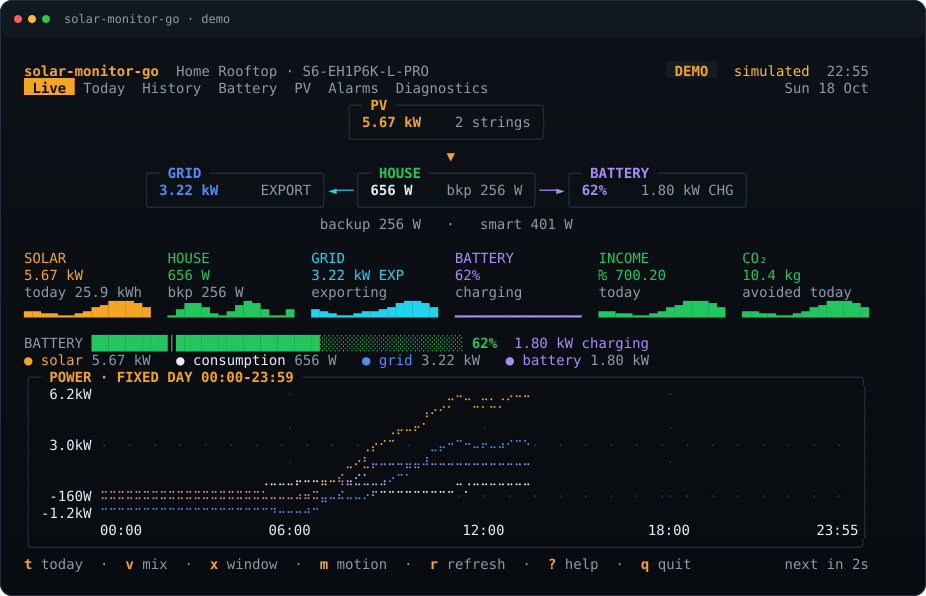
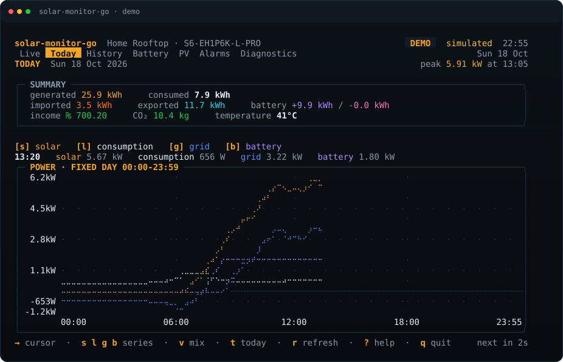
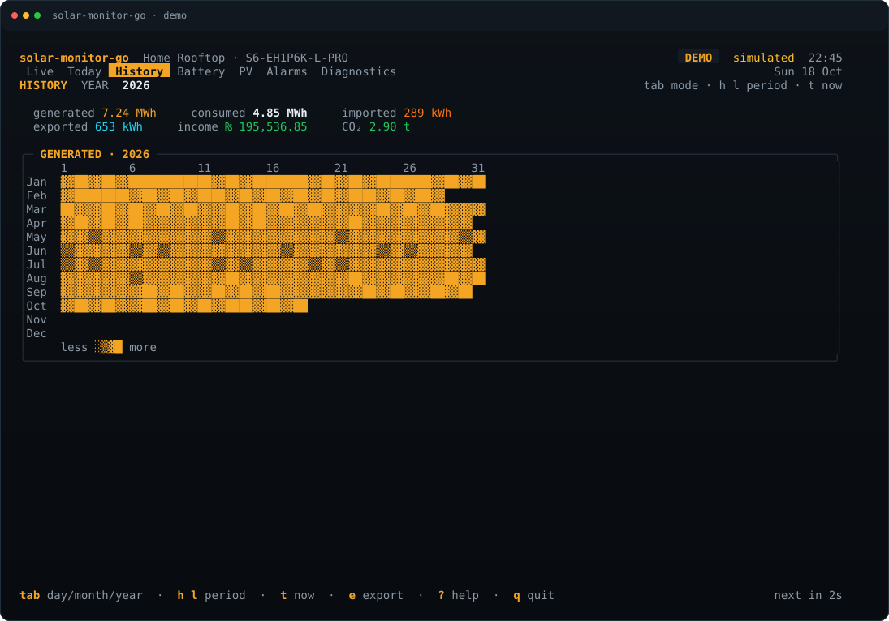
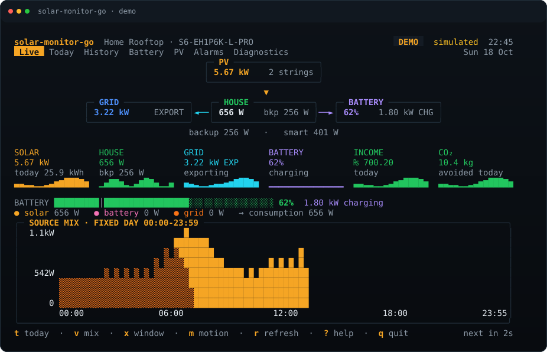
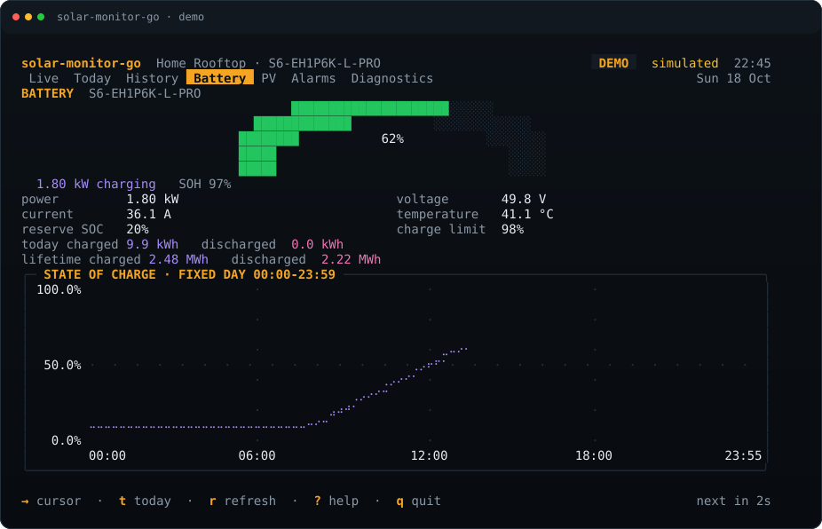
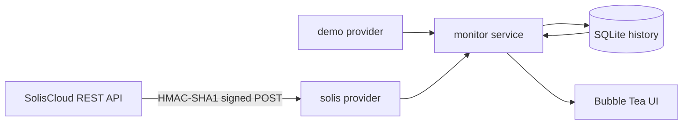

<div align="center">

# solar-monitor-go

**A read-only terminal dashboard for Solis solar inverters.**

[](https://go.dev)
[](LICENSE)
[](https://github.com/farazmazhar/solar-monitor-go/commits/main)
[](#status)
[](https://www.soliscloud.com)



<sub>Demo mode. Live values, a day curve with axes, a battery gauge and an energy-flow diagram — all in the terminal.</sub>

</div>

---

`solar-monitor-go` talks directly to the SolisCloud REST API and turns a Solis
inverter into a fast, good-looking terminal dashboard. It keeps its own local
history, shows what the cloud last reported when the network is down, and ships
a deterministic demo mode so the UI can be explored without credentials.

It is **read-only**: it never changes a setting, starts a charge slot, or sends a
control command to the inverter.

## Contents

- [Why](#why)
- [Screens](#screens)
- [Install](#install)
- [Quick start](#quick-start)
- [Configuration](#configuration)
- [Keys](#keys)
- [Chart styles](#chart-styles)
- [How it works](#how-it-works)
- [Data and history](#data-and-history)
- [Development](#development)
- [Status](#status)
- [License](#license)

## Why

Most solar dashboards want a browser, a cloud account and a tab that stays open.
This one wants a terminal.

- **Live at a glance** — solar, house consumption, grid import/export and
  battery charge/discharge in one screen.
- **A real chart** — time and power axes, a fixed 00:00–23:59 day window,
  a cursor, and a stacked source-mix view.
- **History that stays local** — five-minute samples in SQLite, queried
  instantly, with a day/month/year history view.
- **Honest about freshness** — stale data keeps its age badge; missing values
  show `—` instead of zero.
- **Works offline** — the last snapshot and local samples render when
  SolisCloud is unreachable.
- **Demo mode built in** — the whole UI runs on a simulated sunny day.

## Screens

| | |
|---|---|
|  |  |
| **Today** — summary, series toggles, cursor and a day chart with axes. | **History · year** — calendar heatmap on wide terminals, monthly bars on smaller ones. |
|  |  |
| **Source mix** — `v` stacks solar, battery and grid under consumption. | **Battery** — SOC arc, SOH, throughput and a 24-hour SOC chart. |

Seven screens in total:

| Screen | What it shows |
|---|---|
| **Live** | Energy-flow diagram, live tiles, battery gauge, power chart, source mix |
| **Today** | Summary panel, series legend, cursor line, fixed-day chart |
| **History** | Day chart, monthly bars, yearly calendar heatmap or monthly bars |
| **Battery** | SOC arc, SOH, voltage/current, today and lifetime throughput |
| **PV** | Per-string voltage, current, power and share |
| **Alarms** | Active, recent and all alarms with advice |
| **Diagnostics** | Connection, latency, store stats, raw payload, export, re-discover |

## Install

### Requirements

- **Go 1.27 or newer** to build from source.
- No C toolchain: the SQLite driver is pure Go.
- For live data: SolisCloud API key, secret and station ID.

### Build

```sh
git clone https://github.com/farazmazhar/solar-monitor-go.git
cd solar-monitor-go
make build
```

The binary is `./solar-monitor`. The direct command is:

```sh
go build -trimpath -o solar-monitor ./cmd/solar-monitor
```

### Install to `$GOBIN`

```sh
go install github.com/farazmazhar/solar-monitor-go/cmd/solar-monitor@latest
```

## Quick start

### Demo — no credentials, no network

```sh
make demo
# or
./solar-monitor --demo
```

### Live

```sh
./solar-monitor --init
${EDITOR:-nano} ~/.config/solar-monitor/config.toml
./solar-monitor
```

Get the API key and secret from SolisCloud → **Personal → API Management**
(API access may need to be enabled via a SolisCloud support ticket). The
station/plant ID is in the SolisCloud dashboard URL.

Test the connection before trusting the dashboard:

```sh
./solar-monitor --discover
```

This prints the raw `inverterDetail` payload and a normalised summary.

## Configuration

The config lives at `~/.config/solar-monitor/config.toml` with mode `0600`.
`solar-monitor --init` writes a template. On first run it can also import
credentials from the older `~/.config/solis2kde/config.yaml`.

```toml
[solis]
base_url = "https://www.soliscloud.com:13333"
api_key = "YOUR_API_ID"
api_secret = "YOUR_API_SECRET"
station_id = "YOUR_STATION_ID"
timeout = "30s"

# Optional:
# inverter_id = ""        # auto-discovered from the station
# inverter_sn = ""        # serial-number alternative
# grid_positive = "export"
# battery_positive = "charge"

[poll]
interval = "5m"          # never below 1m
alarms = "15m"
history = "15m"

[display]
theme = "solar-dark"     # solar-dark | transparent
motion = true
chart_style = "braille"  # braille | graph | solid | area | box | quadrant | ascii
chart_smoothing = 3      # moving-average window; 1 = off
day_window = "day"       # day = fixed 00:00-23:59, auto = fit samples
currency = "PKR"
currency_symbol = "₨"
co2_kg_per_kwh = 0.4

[tariff]
import = 0.0
export = 0.0

[storage]
path = "~/.local/state/solar-monitor/monitor.db"
raw_snapshot_days = 30
```

Environment overrides:

| Variable | Purpose |
|---|---|
| `MONITOR_API_KEY` | SolisCloud API ID |
| `MONITOR_API_SECRET` | SolisCloud API secret |
| `MONITOR_STATION_ID` | station/plant ID |
| `MONITOR_INVERTER_ID` | skip inverter discovery |
| `MONITOR_CONFIG` | config path |
| `MONITOR_STATE_DIR` | state directory |
| `MONITOR_THEME` | theme name |

## Keys

| Key | Action |
|---|---|
| `1`–`7` | switch screen |
| `tab` / `shift+tab` | next / previous screen, or cycle a mode/filter |
| `h` `l`, `←` `→` | previous/next period or chart cursor |
| `j` `k`, `↑` `↓` | move in tables, scroll raw data |
| `r` | refresh now |
| `m` | toggle motion |
| `x` | fixed-day ↔ fit-samples chart window |
| `v` | power lines ↔ source-mix stacked area |
| `t` | jump to today / current period |
| `s` `l` `g` `b` | toggle Today series |
| `e` | export JSON or CSV |
| `d` | re-discover inverter (Diagnostics) |
| `?` | help |
| `q` | quit |

Mouse clicks switch tabs and tiles, move the chart cursor, and scroll lists.

## Chart styles

`display.chart_style` chooses the line renderer. All styles draw a bordered
panel, a y axis, an x axis, a cursor, and a subtle grid on tall charts.

| Style | Look |
|---|---|
| `braille` *(default)* | 2×4 dot matrix; smooth curves, best resolution |
| `graph` | ntcharts canvas lines; thin strokes with rounded corners |
| `solid` | half-block lines; thick and readable at small heights |
| `area` | solid lines with a denser solar fill |
| `box` | box-drawing lines with junction merging |
| `quadrant` | quadrant blocks at 2×2 sub-cell resolution |
| `ascii` | `- / \ + *`; minimal-font and `NO_COLOR` fallback |

The solar area fill is drawn in `solid`, `area` and `graph`; braille leaves the
area clear so the dots stay readable. Where two series share a braille or
quadrant cell, their colours blend so an overlap is visible as an overlap.

Try them without editing the config:

```sh
./solar-monitor --demo --chart-style graph
./solar-monitor --demo --chart-style quadrant
./solar-monitor --demo --chart-style solid
```

## How it works



- `internal/provider/solis` signs each request, discovers the inverter and
  normalises units and field aliases.
- `internal/monitor` records every snapshot, merges the API's day curve with
  local samples, and falls back to the store when the cloud is down.
- `internal/store` keeps snapshots, five-minute samples, daily/monthly
  aggregates and alarms.
- `internal/ui` is a Bubble Tea model with custom chart components. It imports
  the provider interface, never a Solis-specific package.

The app respects SolisCloud's five-minute data cadence, the two-requests-per-
second limit, and the ±15-minute clock-skew rule. Failed polls back off from
30 seconds to a five-minute cap.

## Data and history

```
~/.config/solar-monitor/config.toml     credentials and preferences (0600)
~/.local/state/solar-monitor/monitor.db snapshots, samples, aggregates, alarms
```

- Five-minute samples are kept forever (roughly 10 MB per year).
- Raw JSON snapshots are pruned after 30 days by default.
- Year daily data is fetched one month at a time, saved to SQLite, and reused;
  only missing or incomplete months hit the API again.
- Narrow terminals show monthly bars for the year, so the twelve daily requests
  are skipped entirely unless the heatmap is actually shown.
- Nothing leaves the machine except the SolisCloud API requests.

## Development

```sh
make test        # go test ./...
make race        # go test -race ./...
make check       # gofmt, go vet, go test
make demo        # run the TUI with simulated data
make discover    # print a live inverterDetail payload
```

Golden frames live in `internal/ui/testdata` and cover every screen at 60×20,
80×24 and 100×30, plus the chart styles and mix view. Regenerate them
deliberately:

```sh
go test ./internal/ui -update
```

`--dump` renders one frame without starting Bubble Tea, which is useful for
screenshots and smoke checks:

```sh
./solar-monitor --demo --dump --dump-size 120x40
./solar-monitor --demo --dump --dump-tab 2 --dump-history year
./solar-monitor --demo --dump --dump-view mix
```

The README screenshots are generated from demo mode, so they contain no account
data.

## Status

Working end to end on demo data and the real API path. The remaining gap is
**live field and sign verification** against a real account: the mappings come
from the vendor document and the older KDE project, and `--discover` is the
fastest way to confirm them.

Planned: richer empty/error states, screenshots from a real station, and a
first tagged release.

See [`docs/STATUS.md`](docs/STATUS.md) and [`AGENTS.md`](AGENTS.md) for the
detailed, living plan and handoff notes.

## License

MIT — see [LICENSE](LICENSE).
